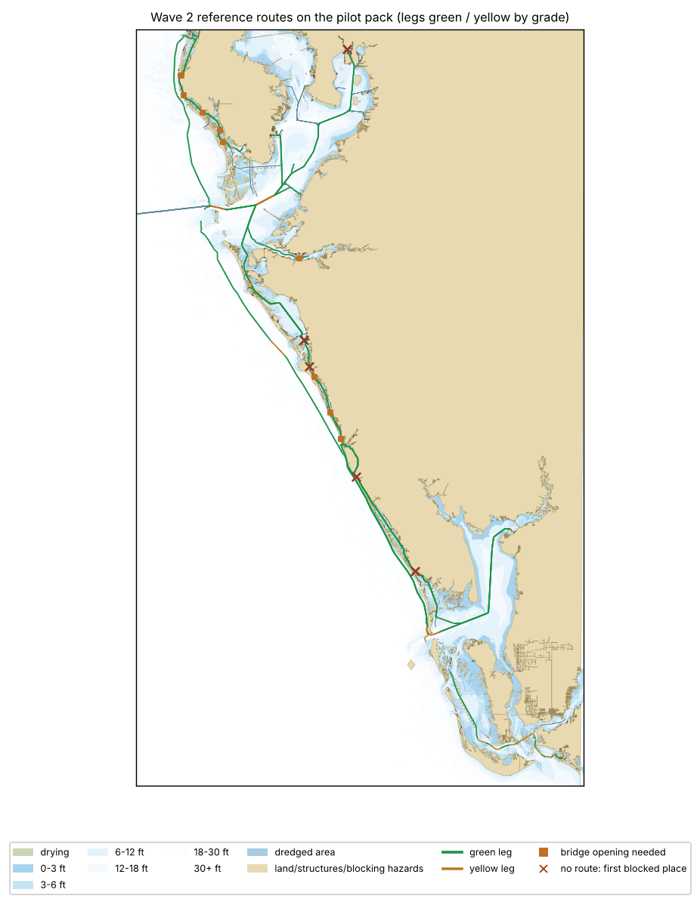
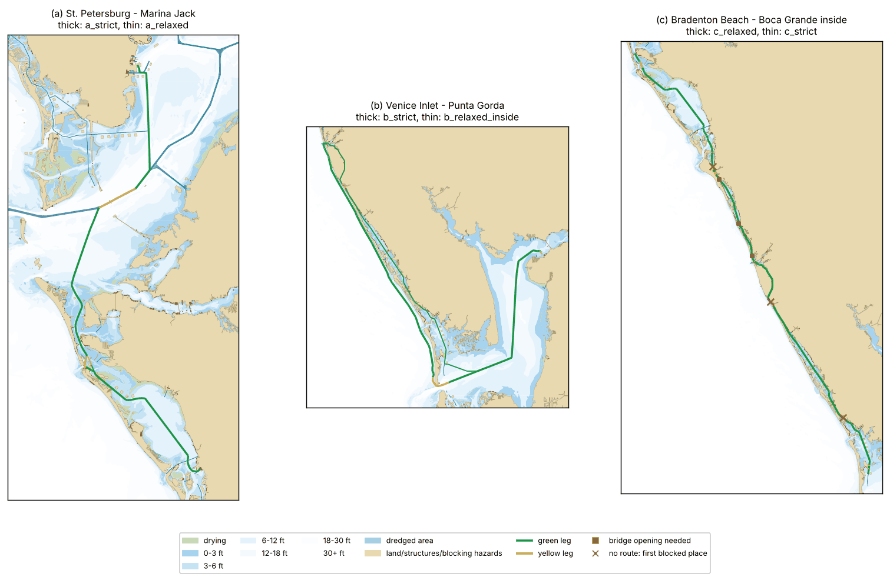
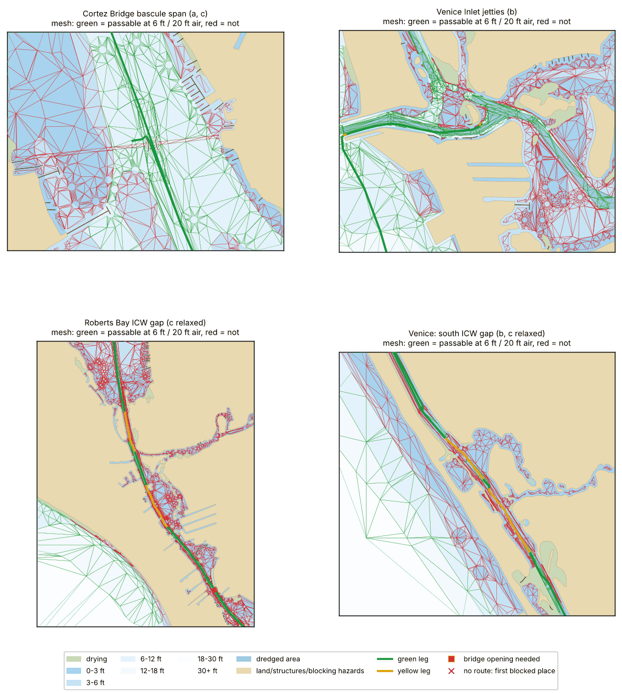

# Spike: routing data from NOAA ENC, Tampa Bay to Charlotte Harbor

Status: Wave 1 spike, 2026-11-12. Code: [`pipeline/routing`](../../pipeline/routing) (CLI `python -m enc_routing all`, 19 offline tests). Every number below comes from running that pipeline on the ENC catalog of 2026-11-11. Outputs live in the session scratchpad, not in the repo.

## Summary

- **The pipeline works end to end.** It runs catalog, download, extract, multi-scale merge, safe-water polygons, mesh, A*, and render in about 5 minutes cold. The pilot area needs 103 cells (12.0 MB zipped).
- **The ENC alone says the inside route from Tampa Bay to Charlotte Harbor is impossible at any draft of 3 ft or more.** Two stretches of the Intracoastal Waterway (ICW) are charted in the 0–3 ft band with no dredged area. One is in Roberts Bay, Sarasota (about 1 km). The other is south of Venice (about 0.7 km). The USACE National Channel Framework (NCF) says both are maintained at 9 ft. A router needs the NCF to produce the route every local skipper actually runs, and must flag those legs as "project depth, not surveyed".
- **The mesh approach works.** It uses a constrained Delaunay triangulation (CDT) of all navigable water, with least depth, clearance and flags per triangle. One mesh serves every boat. The pilot mesh has 494k triangles, 316k vertices, 669k adjacencies, and is 6.4 MB zlib-compressed in a naive layout or about 3.3 MB in a compact layout. A* plus string-pulling takes 0.1–0.45 s per query in plain Python. Projected to the whole Gulf: about 6.7 M triangles and about 45 MB compact, about 87 MB naive.
- **Route quality:** routes (a) and (b) look like routes a navigator would take. Route (c) fails in strict mode, which is the correct reading of the chart. In relaxed mode it follows the real ICW but needs three bridge openings. Details, defects included, are in section 7.
- **The data problems that will bite:** coarse depth bands (4, 5 and 6 ft give identical answers), metric depths truncated from feet, project depths instead of controlling depths, 72% of hazards without a depth, opening bridges charted as several parts, and surveys mostly from 1940–1970.

## 1. Cells

The pilot box (lon -83.3 to -81.9, lat 26.3 to 28.1) is intersected with the catalog `<cov>` panels. Type E panels are exterior rings and type I panels are holes; there is one type I panel in the whole catalog. That leaves 103 active cells.

| band | cells | notes |
|---|---|---|
| 1 overview | 1 | US1GLBCF, fully superseded |
| 2 general | 1 | US2GOACD, fully superseded |
| 3 coastal (1:180k) | 6 | wins 7,467 km² of the box (open Gulf) |
| 4 approach (1:45k–90k) | 27 | wins 16,160 km² |
| 5 harbour (1:12k–22k) | 68 | wins 4,032 km² (all the inside water) |

- Size: 12.0 MB zipped and 37 MB unzipped, base cells plus 0–3 updates each. The download took 5 s with 6 threads.
- All 103 cells have the same DSPM: HDAT=2 (WGS 84), SDAT=12 (soundings and depth areas at MLLW), VDAT=16 (heights and clearances above MHW), DUNI=1 and HUNI=1 (metres).
- `DSID_UPDN` after `UPDATES=APPLY` matches the catalog `updn`, so updates are being applied.

Cell selection is a minimal reimplementation (`enc_routing/catalog.py`). It duplicates part of `pipeline/catalog` and should be consolidated in Wave 2.

## 2. Extraction

GDAL S57 driver via pyogrio, with options `UPDATES=APPLY,SPLIT_MULTIPOINT=ON,ADD_SOUNDG_DEPTH=ON,LNAM_REFS=ON`. It reads all cells in 21 s and the result is cached per cell edition/update.

| class | extracted (all cells) | kept after merge |
|---|---|---|
| DEPARE / DRGARE | 11,529 / 885 | 6,811 / 546 |
| LNDARE / COALNE / SLCONS | 5,823 / 9,584 / 10,764 | 2,335 / 4,677 / 6,548 |
| UNSARE / PONTON / PILPNT | 499 / 586 / 3,662 | 249 / 446 / 2,235 |
| OBSTRN / WRECKS / UWTROC | 2,988 / 708 / 363 | 1,310 / 210 / 115 |
| SOUNDG (split points) | 56,737 | 29,258 |
| BRIDGE / CBLOHD / PIPOHD | 940 / 465 / 25 | 452 / 245 / 13 |
| FAIRWY / RECTRC / NAVLNE / DWRTCL | 334 / 145 / 107 / 0 | 204 / 91 / 65 / 0 |
| RESARE / CTNARE | 86 / 529 | 37 / 243 |
| BOYLAT / BCNLAT / BOYSPP / BCNSPP | 409 / 5,363 / 197 / 1,589 | 203 / 2,648 / 68 / 761 |
| M_COVR / M_QUAL | 104 / 2,339 | used for the merge / 1,432 |

**Depth encoding gotcha.** The DRVAL1 values present are 0, 0.9, 1.8, 3.6, 5.4, 9.1, 10.9, 18.2 … m: the 0, 3, 6, 12, 18, 30, 36, 60 ft contours. NOAA converts feet to metres and **truncates** to 0.1 m: 12 ft (3.658 m) is stored as 3.6 and 36 ft as 10.9. A threshold of T ft must therefore be compared with `floor(T·0.3048·10)/10`. Comparing 6 ft (1.8288 m) with DRVAL1 = 1.8 using exact metres silently drops every 6-ft area. The same rule is applied to VALSOU. `safewater.chart_metres()` has a test for it.

## 3. Multi-scale merge

**Rule.** Every point belongs to exactly one cell: the highest-priority cell whose M_COVR (CATCOV=1) covers it. Priority is band first, then larger scale, then newer issue date. Cells are processed in priority order. Each gets an exclusive region (its coverage minus everything already claimed), and all of its features are clipped to that region. Clipping keeps the geometry dimension, which matters: intersections otherwise produce GeometryCollections that silently drop land. As a result there is no double counting, and the overview cell guarantees there are no holes.

**Numbers.**

- **Overlap.** 79,543 km² of coverage is superseded by higher-priority cells (cross-band overlap is the normal case). Only 2,772 m² of overlap is between cells of the same band.
- **Slivers.** 46 sliver pieces, 40,372 m² in total, lie where two harbour cells *nearly* meet and a lower band would otherwise fill a hairline strip. They are removed by a 5 m morphological closing of the claimed region before differencing. This leaves 0.04 km² of the box owned by no cell. That residue is healed later by a 5 m closing of the safe-water union, and land is subtracted after the closing, so jetties survive.
- **Skin of the earth check.** Group-1 objects must tile each exclusive region. The check finds 0 m² of gaps (after fixing the dimension bug) and 31,108 m² of overlap, all in one cell (US5TPAHI, pontoons over depth areas).
- **Grid.** NOAA's new gridded harbour cells meet on exact lat/lon lines, which is why slivers are rare. Most slivers are at harbour/approach boundaries drawn by hand.

## 4. Safe-water polygons and connectivity

**How safe water is built.**

1. Start from depth areas (DEPARE and DRGARE) with `DRVAL1 ≥ chart_metres(T)`, then apply a 5 m closing.
2. Subtract land and structures:
   - LNDARE;
   - SLCONS (lines buffered 3 m);
   - PONTON, HULKES, FLODOC, DRYDOC, DAMCON, GATCON and DYKCON (2 m);
   - piles (5 m);
   - UNSARE;
   - causeways, minus their bridge spans.
3. Subtract hazards (OBSTRN, WRECKS, UWTROC; points buffered 10 m, areas 10 m) whose VALSOU is unknown or shallower than T. Foul ground (CATOBS 7) is not a hazard.

| T (ft) | compared at (m) | area km² | parts ≥100 m² | parts ≥1 km² |
|---|---|---|---|---|
| 3 | 0.9 | 17,233 | 126 | 3 |
| 4 | 1.2 | 16,914 | 121 | 4 |
| 5 | 1.5 | 16,913 | 119 | 4 |
| 6 | 1.8 | 16,913 | 116 | 4 |
| 8 | 2.4 | 16,202 | 89 | 10 |
| 10 | 3.0 | 16,195 | 71 | 10 |
| 15 | 4.5 | 15,625 | 29 | 5 |

The 4, 5 and 6 ft rows are effectively identical because there is no contour between 3 and 6 ft. Only a few DRGAREs have intermediate values.

**"Inside" mask.** The open Gulf is defined as the water connected to a seed point offshore, after closing the land mass with a radius of 1.5 km (this seals the passes) and drawing a line across Tampa Bay mouth.

**Is the ICW continuous at 4 ft and 6 ft? No.** The breaks found are the same at 3, 4, 5 and 6 ft:

| where | gap | chart says | USACE NCF says |
|---|---|---|---|
| Roberts Bay, Sarasota (27.2745 N, 82.5436 W and 27.2648 N, 82.5393 W) | 397 m + 621 m | DEPARE 0–0.9 m, no DRGARE, 3 obstructions of unknown depth at the channel edge; the beacons and RECTRC continue through | Cuts S-36 to S-38, 9 ft maintained, 100 ft wide |
| South of Venice (27.0458 N, 82.4334 W and 27.0413 N, 82.4299 W) | 214 m + 486 m | DEPARE 0–0.9 m, soundings of 0–3 ft, no DRGARE; marked by beacons | Cuts S-8 and S-9, 9 ft maintained |
| Clearwater (28.0374 N, 82.7968 W), 4 ft and above | 175 m | drying / 0 m | not checked |

At 8 ft the ICW breaks into about 20 pieces, because its project depth is 9 ft (DRGARE 2.7 m) and the natural bays between the dredged cuts are charted at 6–12 ft.

**Tampa Bay to Charlotte Harbor inside, at 5 ft? No, by charted depth.** The inside water splits into three components at the two gaps. The first holds Tampa Bay, Boca Ciega, Anna Maria Sound, Sarasota Bay and Roberts Bay. The second holds Little Sarasota Bay and Venice. The third holds Lemon Bay, Gasparilla Sound, Charlotte Harbor, Punta Gorda and Pine Island Sound. **Yes, if the USACE project depth is trusted**, and also an overhead cable of unknown clearance near Placida (26.849 N, 82.296 W) is accepted. See route (c).

## 5. Channels

**ENC.**

- RECTRC: 91 features, 305 km, of which 200 km is "Gulf Intracoastal Waterway". 78% of that ICW track lies inside ICW DRGAREs.
- FAIRWY: 204 polygons, 493 km².
- DRGARE: 546 polygons, 31.5 km². 53 are named ICW, all with DRVAL1 = 2.7 m (the 9 ft project depth). The INFORM text says "Project depth … consult USACE for controlling depths".
- NAVLNE: 65 unnamed lines, 180 km. DWRTCL: none.
- Lateral marks: 2,648 BCNLAT and 203 BOYLAT.

The ENC ICW is dense enough to use as a highway in most places: the RECTRC is continuous and the DRGARE covers most of it. It is not reliable as a depth source exactly where it matters, because it stops at shoaled reaches. Minor channels have only beacons, so their centrelines would have to be inferred from beacon pairs.

**USACE NCF.** The FeatureServer at `services7.arcgis.com/n1YM8pTrFmm7L4hs/.../National_Channel_Framework/FeatureServer` is reachable and covers the pilot.

| layer | features in the pilot | notes |
|---|---|---|
| 0 ChannelLine | 758 (1,330 km) | 274 centerlines (456 km, of which 252 km GIWW) and 483 toe lines |
| 1 ChannelArea | 30 | |
| 2 ChannelReach | 331 | 173 at 9 ft |
| 3 ChannelQuarter | 978 | |

Fields:

- ChannelReach: `sdsfeaturename, sdsfeaturedescription (cut id), depthmaintained, depthauthorized, widthfrom, widthto, mileagestart, mileageend, channelreachtype, dateuploaded`.
- ChannelLine: `sdsfeaturedescription (Centerline/ToeLine), sdsfeaturename, depthclassification, statusdate, channelareaidfk, channelreachidfk`.

Data problems in the NCF:

- `channellinetype` is null everywhere.
- 4 ChannelLine records have garbage XML/base64 in `sdsfeaturename`, which looks like a field shift.
- Reach polygons sit 1–30 m off the ENC channel. A face sampled just outside an NCF reach lost its project depth until NCF limits were made explicit mesh constraints.

**Recommendation.** Use NCF reaches as the channel and project-depth layer, and NCF centerlines as highway edges. Keep ENC depth as the truth, and grade legs that rely on project depth yellow. The real controlling depths are in eHydro surveys (not checked here).

## 6. Bridges and overhead cables

Over navigable water, 390 BRIDGE parts were found. Only 155 have a clearance: 123 with VERCLR and 32 with VERCCL. **VERCOP (open clearance) is never populated.** 62 parts are named and 34 are opening spans (bascule, swing or generic opening).

For overhead cables, 169 are over water and 85 have VERCLR. VERCSA is never populated, and 9 cables are duplicated geometries. For overhead pipes, 10 are over water and 4 have VERCLR.

**Key pitfall.** An opening bridge is charted as the opening span (CATBRG 2/3/5 with VERCCL) plus fixed deck and approach pieces with no clearance. The first router went under those pieces. A causeway polygon (CAUSWY) is also charted straight across the bascule span of Welch Causeway, which cut the ICW until bridge footprints were subtracted from causeways. Now any BRIDGE part with no clearance is treated as solid, and cables or pipes without clearance are "unknown": blocked in strict mode, allowed with a penalty and a flag in relaxed mode.

Clearances in ft above MHW, from the chart, on the inside routes:

| route segment | fixed | opening (closed clearance) |
|---|---|---|
| Boca Ciega / Pinellas | Pinellas Bayway 65, 20, 18, 11; Treasure Island fixed parts 4–5; Seminole 20; Sunshine Skyway 180 | Johns Pass 28; Treasure Island bascule 21; unnamed at 27.746 N, 23 |
| Anna Maria / Sarasota | Ringling Causeway A 65 (B 10) | Anna Maria Island 24; Cortez 22; Longboat Pass 17; New Pass 23; Siesta Drive 25; Stickney Point 18 |
| Casey Key / Venice | — | Blackburn Point swing 9; Albee Road 14; Venice Ave 30; unnamed 30 (27.100 N); unnamed 25 (27.079 N) |
| Lemon Bay / Gasparilla | Gasparilla Sound 26 / 16 | Manasota 26; Tom Adams 26; Gasparilla Island swing 22 |
| Caloosahatchee / Sanibel | Sanibel Causeway 70 / 26 / 9; Cape Coral 55; Midpoint 55 | Pine Island Road 9 |

Overhead cables over water have clearances of 17–98 ft. The lowest, 17–23 ft, are a real constraint for sailboats.

## 7. Prototype router

**Graph.** One mesh is built for all boats.

1. The water domain is DRVAL1 ≥ 0, closed by 5 m, minus land and structures, then simplified by 2 m.
2. It is cut into 45,909 faces along every boundary that changes passability: depth-area edges, hazard clearance rings, bridge and cable footprints, FAIRWY/RECTRC/NCF channel limits, the Gulf mask and a 2 km grid that bounds triangle size.
3. Each face is triangulated with the GEOS CDT. It adds no Steiner points, so neighbouring faces share edges exactly.
4. Two repair steps were needed. GEOS emits flat (zero-area) triangles along collinear boundary vertices; each one hides a T-junction, so the triangle across it is split. 37 further T-junctions are split explicitly. 128 non-manifold edge occurrences remain (edges shared by four triangles, caused by near-coincident vertices), and so do 4 T-junctions.

Per triangle the mesh stores: least depth (depth area, lowered to any hazard's VALSOU, or -1 for unknown), USACE maintained depth, least overhead clearance, and flags (channel, opening bridge, open Gulf, unknown clearance).

**Query.**

1. Triangles are filtered by depth ≥ draft + margin (6 ft, compared at 1.8 m), clearance ≥ air draft (20 ft), or an opening bridge, and optionally by the inside-only mask.
2. A* runs over triangle adjacency, with edge-midpoint positions and Euclidean cost. Cost factors: 0.9 in channels; 1.25 off-channel with less than 1 m to spare; ×3 where only project depth makes a triangle passable. Penalties: +1.5 km when an opening is actually needed, +3 km under an unknown clearance.
3. The corridor is straightened with the funnel algorithm, then each corner is nudged 8 m off the corridor edge when both legs stay inside.

Shrinking the portals instead was tried and produced paths through land, so it was removed.

**Size and speed** (pilot, Python):

| | |
|---|---|
| vertices / triangles / interior edges | 316,002 / 494,424 / 668,897 |
| naive pack (int32 vertices; uint32×3 vertex ids + int32×3 neighbours + 6 B attributes) | 17.4 MB raw (35 B per triangle), 6.4 MB zlib |
| compact pack (delta-coded, neighbours rebuilt on load) | 3.3 MB zlib (6.8 B per triangle) |
| build time | about 3.6 min (noding plus polygonize 135 s, CDT 40 s) |
| mesh load + STRtree | 0.6 s |
| A* | 0.09–0.45 s, 10k–32k triangles expanded |
| funnel | 0.02–0.03 s |

**Projected to the Gulf.** Triangle count is driven by harbour and approach detail. In zipped band 4–6 bytes, the Gulf (TX to the Keys, Atlantic side excluded) has 131.8 MB against the pilot's 9.7 MB, a factor of 13.6 (1,213 cells against 95). That gives about 6.7 M triangles: about 87 MB zlib in the naive layout, or **about 45 MB compact**. That is roughly 10–20 MB per region for the five chart regions, inside D3's 20–80 MB estimate. A Swift A* over a typed array should be one to two orders of magnitude faster than this Python.

**The three routes** (boat: 4.5 ft draft + 1.5 ft margin, 20 ft air draft). "Strict" uses charted depth and known clearances only. "Relaxed" also trusts USACE maintained depth inside NCF reaches and allows unknown overhead clearance, both flagged.

| route | strict | relaxed |
|---|---|---|
| (a) St. Petersburg → Marina Jack | 33.3 nm; least charted depth 6 ft; 77% in channel; no openings needed (Anna Maria 24 ft, Cortez 22 ft closed) | 33.0 nm, nearly the same; 5 triangles rely on project depth |
| (b) Venice Inlet → Punta Gorda | 47.4 nm, outside: Venice Inlet, Gulf, Boca Grande Pass, Charlotte Harbor; goal snapped 524 m (the marina basin is charted under 6 ft) | 46.2 nm, inside via the ICW: 9 triangles on project depth (south-Venice gap), 6 opening bridges all with closed clearance ≥ 22 ft (no opening needed), 1 cable of unknown clearance at Placida |
| (c) Bradenton Beach → Boca Grande, inside | **no path** (Roberts Bay and south-Venice gaps) | 52.1 nm, 98% in channel; 52 triangles on project depth; unknown-clearance cable at Placida; **3 openings required**: Stickney Point (18 ft), Blackburn Point swing (9 ft), Albee Road (14 ft) |

**How the routes look to a navigator.**

- **(a) Sensible.** It leaves the St. Petersburg basin by the dredged harbour channel and follows the channel south. It crosses Tampa Bay on 6–12 ft and deeper water, enters Anna Maria Sound, and then runs between the ICW beacons down Sarasota Bay. Weak points:
  - Parts of the Tampa Bay crossing ride exactly on the 6-ft contour, with zero spare depth beyond the margin.
  - The bridges pass with only 2–4 ft above MHW.
- **(b) Strict: legitimate but not ideal.** It runs 0.3–0.5 nm off the beach along the 6–12 ft band. A skipper would stand further off in any swell. It also passes within 1–3 m of the south Venice jetty for about 18 m, because the jetty's 3 m buffer is not respected after the 2 m domain simplification and the corner nudge. That is a real defect to fix (see Wave 2). Relaxed: this is the ICW run a local would take.
- **(c) Strict: correct by the chart.** Relaxed: follows the real ICW, through every cut and bridge, with the honest caveat list above.

In no mode does any route pass under a fixed bridge lower than 20 ft. That was checked against the bridge footprints. After the fixes, routes stay inside their triangle corridors. They cross the unsimplified obstacle layer by 0.3–18 m in total.

## 8. Data-quality problems that will bite

1. **Coarse depth bands.** Contours are at 0, 3, 6, 12 and 18 ft. Boats needing 4–5 ft get the same answer as 6 ft. In the pilot, 32% of the soundings inside the 3–6 ft band are 6 ft or deeper, and 175 soundings inside the 0–3 ft band are 6 ft or deeper. Refining with soundings (a TIN inside each band) is possible but unproven; do not ship it without validation.
2. **Truncated metric depths.** See section 2. Getting this wrong loses whole depth bands.
3. **Project depth, not controlling depth.** Every ICW DRGARE is 2.7 m (9 ft project). The real shoals show up as gaps where the chart has 0–3 ft. NCF supplies the authorised and maintained depth; controlling depth is only in eHydro surveys.
4. **Hazards without depth.** 1,177 of 1,633 hazards (72%) have no VALSOU, including 954 of 1,310 obstructions, many of them "stumps / piles" (CATOBS 1) at channel edges. All of them block. A 25 m clearance radius nearly closed 60 m-wide ICW cuts, so 10 m is used.
5. **Old and low-quality surveys.**
   - CATZOC by water area: A1 10.7%, A2 0.6%, B 27.2%, C 60.8%, D 0.7%.
   - Last survey year (SUREND): 79.6% between 1940 and 1970, 11% after 2010.
   - DRGARE source dates (SORDAT) run from 1974 to 2025, median 2022.
6. **Bridges and cables.**
   - Clearance is missing on 60% of over-water BRIDGE parts, VERCOP never appears, and opening bridges are split into several parts.
   - Overhead cable data has duplicates and missing clearances; one cable crossing the ICW at Placida has no VERCLR.
   - Causeways are charted across bridge spans.
7. **Slivers and gaps.** These were small here (46 slivers, 4 ha), thanks to the gridded harbour cells. They need watching where approach-band cells fill between harbour cells.
8. **Geometry robustness.** GEOS CDT produces flat triangles, and some T-junctions and quadruple edges remain. The domain simplification (2 m) is not conservative.
9. **Endpoints.** Marinas are often charted too shallow, or not at all. The snapping distances seen were 25–524 m.
10. **Not yet used.** RESARE contains 2 entry-prohibited areas (RESTRN 7) that are not honoured yet. State manatee and no-wake zones are not in the ENC.

## 9. Proposal for Wave 2: routing pack and builder

**Pack:** one file per chart region, `routing-<region>-<yyyymmdd>.pack`. It is little-endian, and each section is LZFSE- or zlib-compressed so the app can decompress it into memory-mappable arrays.

| section | content | bytes |
|---|---|---|
| header | magic, version, region, build time, bbox, list of source cells with edition, update and issue date (for "chart data date"), thresholds used | ~10 KB |
| vertices | lon/lat as int32 at 1e-7°, sorted along a Morton curve and delta-coded. The Gulf spans UTM zones 14–17, so the phone uses a local equirectangular metric. | ~3 B per vertex compressed |
| triangles | 3 vertex indices, delta-coded. Neighbours are rebuilt at load (fast) or stored, depending on Swift profiling. | |
| attributes | depth in dm (int16, -1 = unknown hazard), project depth in ft (uint8), overhead clearance in dm (uint16; none and unknown reserved), flags (uint8: channel, opening bridge, outside, unknown clearance, restricted), quality (uint8: CATZOC and survey decade, for leg grading) | 6–7 B per triangle |
| point index | uniform grid (about 1 km) mapping to triangle-id ranges, for locating the start and goal | small |
| side tables | bridges (name, type, closed clearance, position, NCF/ENC ids), named channels, and a hazard list (position, radius, VALSOU, WATLEV) for leg re-validation and green/yellow/red grading | <1 MB |

Expected size: about 3–4 MB for the pilot, and about 45 MB for the Gulf across 5 regions.

**Builder** (Python, server-side):

- **Catalog-driven and incremental.** Extraction is cached per cell edition and update.
- **Tiled.** Merge and mesh in tiles of 0.25–0.5° with stitched, shared boundary vertices, so a changed cell rebuilds only its tiles. This also parallelises the slow noding step, which took 135 s single-threaded for the pilot.
- **Conservative simplification.** Erode water by a clearance (10–15 m from land and structures) instead of simplifying it, and store distance-to-hazard per triangle as a cost term. This fixes jetty-hugging and beach-hugging.
- **Robust triangulation.** Either snap-round the vertices before the CDT, or use a CDT with Steiner points. It must have a permissive licence: an own implementation, or BSD-licensed code in the poly2tri style. CGAL is GPL/commercial, so it is out.
- **Inputs to add:**
  - NCF reaches and centerlines as highway edges, with project depth;
  - RESARE entry-prohibited areas;
  - eHydro survey dates and depths (later).
- **Consolidate catalog code** with `pipeline/catalog`.
- **Swift port** of the passability model, A*, funnel and nudge (RoutingKit). The Python version here is the reference implementation and its tests should be mirrored.

## 10. Reference routes for regression testing

Each entry lists the expected property; the length tolerance is ±10%.

1. **St. Petersburg municipal marina → Marina Jack, 6 ft / 20 ft.** Inside via Anna Maria Sound, about 33 nm, no openings needed.
2. **Venice Inlet → Punta Gorda, strict.** Outside via Boca Grande Pass, about 47 nm. In relaxed mode, inside via the ICW at about 46 nm.
3. **Bradenton Beach → Boca Grande, inside, strict.** Must fail at Roberts Bay and south of Venice. In relaxed mode about 52 nm, with openings at Stickney Point, Blackburn Point and Albee Road.
4. **The same as 3 with a 9 ft air draft.** No openings needed except Blackburn Point (9 ft closed, at the limit).
5. **Clearwater Pass → Johns Pass inside.** Treasure Island fixed parts at 4–5 ft must never be used, and the bascule at 21 ft must be.
6. **Boca Ciega Bay → Tampa Bay with a 70 ft air draft.** Must not pass under the Pinellas Bayway (65 ft). It should exit Pass-a-Grille or fail.
7. **Fort Myers Beach → Captiva via San Carlos Bay.** Must use the 70 ft Sanibel Causeway span and avoid the 9 ft one.
8. **Tampa (Harbour Island) → Egmont Key with 15 ft draft.** Must follow the dredged ship channel and pass under the Sunshine Skyway (180 ft).
9. **Port Manatee → Bradenton (Manatee River).** River bridges.
10. **Negative tests.**
    - Start on land: expect an error.
    - Start in a marina basin: expect a snap of 600 m or less.
    - Sarasota Bay at 15 ft draft: expect no path.
    - Ringling Causeway at 66 ft air draft: expect no inside route.
11. **Open-water leg: Egmont Key → Boca Grande Pass offshore.** Must not hug the beach (minimum distance-to-shore check once that cost exists).

## Hosts

All hosts used were allowed: www.charts.noaa.gov for the cell zips (the catalog itself came from the provided local copy of today's file) and services7.arcgis.com for the NCF. No host was refused.

## Wave 2 follow-up (2026-11-12)

The spike is now the routing-pack builder and reference router. The format, the algorithm and the builder rules are specified in [`docs/routing-pack-format.md`](../routing-pack-format.md). The test vectors are in [`testdata/routing`](../../testdata/routing). The figures above have been regenerated from the Wave 2 pack: legs are green or yellow by grade, and an × marks the first blocked place of a failed route.

**Pilot pack.**

- **Size and contents.** `routing-pilot-20261023.pack` is 4.30 MB, holding 548,089 vertices and 860,420 triangles. The data date of 2026-10-23 is the newest ENC issue date used.
- **Sections:**
  - vertices 2.00 MB;
  - triangles 1.45 MB;
  - attributes 0.53 MB;
  - point index 0.20 MB;
  - side tables 0.10 MB;
  - adjacency not stored: it is derived on load, and storing it would add 1.7 MB.
- **Build time.** A full mesh build takes 206 s on 4 cores. The no-op rebuild is 2.5 s.
- **Speed.** The Python reference takes 0.9 s to load and 0.2–0.8 s per route, or about 3 s when it has to produce a no-route report.

**Defects from section 7, and their status.**

| defect | Wave 2 |
|---|---|
| 2 m simplification is not conservative; jetty within 1–3 m | **Fixed.** Water is shrunk by 12 m from land, structures and blocking hazards (Douglas–Peucker on a 14 m buffer). Two exceptions: 4 m within 60 m of bridges, and 3 m from fenders, because the bascule and swing openings at Cortez, Blackburn Point and Manatee River are 25–40 m wide and close at 12 m. Measured on the raw source data, the 13 successful pilot routes come no closer to land, structures or blocking hazards than 13.3 m outside bridge zones, 5.7 m inside them and 4.1 m to fenders. A regression test asserts this on the Sarasota cut. |
| beach and jetty hugging | **Partly fixed.** Cost factors for within 50 m and 50–150 m of shore, near hazards, and less than 0.3 m or 1 m of spare depth. The legs keep at least 50 m from shore whenever the corridor allows. Route (b) strict still runs a median of 0.38 nm off the Gulf beaches: in 6–12 ft water that is legitimate by the chart, but it is not a wide offing. |
| RESARE entry-prohibited not honoured | **Fixed.** Prohibited is impassable; restricted and caution are flagged with a cost factor and grade yellow. |
| non-manifold edges and T-junctions | **Fixed.** Snap-rounding on the 1e-7° grid before the CDT, then exact integer repairs. The pilot mesh has 0 flat triangles, 0 T-junctions, 0 duplicate directed edges, and the triangles' area equals the faces' area exactly. Validation fails the build otherwise. |
| coarse depth bands | **Sounding refinement added** (spec C.4). Of 314 km² in the 3–6 ft band, 14.5 km² becomes usable at a 4 ft requirement and 5.4 km² at 5 ft (+1.0 km² at 6 ft); such legs grade yellow (SOUNDING_DEPTH). **The ICW gaps remain**, at 4 ft and 5 ft, with and without refinement: Roberts Bay and south of Venice are in the 0–3 ft band, and the raise is capped at the band's DRVAL2. |
| truncated metric depths | **Fixed everywhere.** One rule (`req_dm`) covers depths, clearances and USACE feet. The requirement is rounded up to whole feet. |

**Reference routes** (boat 4.5 ft draft + 1.5 ft margin, 20 ft air draft unless stated; "relaxed" = maintained channels and unknown clearance accepted):

| route | result | nm | legs green / yellow | verdict |
|---|---|---|---|---|
| a strict, St. Pete → Marina Jack | ok | 33.4 | 123 / 18 | Good. Harbour channel, across Tampa Bay, under the Skyway, Anna Maria Sound, Sarasota Bay. Anna Maria (73 dm) and Cortez (67 dm) bascules pass closed. Yellow only for caution and restricted areas. |
| a relaxed | ok | 33.1 | 123 / 12 | Good. Nearly the same, with a few maintained-depth legs. |
| b strict, Venice Inlet → Punta Gorda | ok | 47.2 | 92 / 22 | Correct by the chart: out the inlet (13.4 m off the jetty), Gulf, Boca Grande Pass. Median 0.38 nm off the beach. |
| b relaxed | ok | 47.4 | 87 / 24 | Still chooses the outside: it is cheaper than the inside with its maintained-depth factor and the Placida cable penalty. Acceptable, but not the local choice. |
| b relaxed, inside only | ok | 45.4 | 175 / 10 | The ICW run: south-Venice gap on maintained depth, Placida cable of unknown clearance, no openings needed. Matches the spike. |
| c strict, Bradenton Beach → Boca Grande inside | no route | – | – | Correct. Blocked at Roberts Bay (27.276 N), then south of Venice (27.046 N), then the Placida cable. Neither option alone would help. |
| c relaxed | ok | 52.2 | 293 / 40 | Good. Openings flagged at Stickney Point (27.254), Blackburn Point (27.180) and Albee Road (27.124), exactly as in the spike. Unknown cable at Placida. |
| ref 4: c relaxed, 9 ft air | ok | 52.2 | 297 / 36 | Correct. No openings needed; Blackburn Point closed 27 dm = 9 ft, at the limit. |
| ref 5: Clearwater → Boca Ciega inside | ok | 18.5 | 122 / 0 | Good. Treasure Island bascule (64 dm) passes closed; the 4–5 ft fixed parts are never crossed. |
| ref 6: Boca Ciega → Tampa Bay, 70 ft air | ok | 54.7 | 178 / 13 | Safe but long. Never under the 65 ft Bayway. It goes north through 6 bascule openings and out Clearwater Pass, rather than failing. |
| ref 7: Fort Myers Beach → Pine Island Sound, 30 ft air | ok | 23.3 | 69 / 49 | Good. Sanibel Causeway span at 213 dm (70 ft); never the 9 ft span. Many THIN_MARGIN legs (CATZOC C, 0 spare). |
| ref 8: Harbour Island → Egmont, 15 ft | no route | – | – | Honest. The berth is charted 6 ft; the hint says maintained channels would help. |
| ref 8b: same, maintained | ok | 32.6 | 55 / 12 | Good. Ship channel and the Skyway main span (548 dm). |
| ref 9: Port Manatee → Bradenton | ok | 18.9 | 62 / 9 | Good. Skyway, Green fixed bridge (124 dm), then the Manatee River bascule (15 dm closed) flagged as needing an opening. |
| ref 10a: start 3 km inland | error | – | – | Correct: START_NO_WATER_NEARBY. |
| ref 10b: Gulfport marina basin | ok | 2.2 | 7 / 2 | Correct: snapped 231 m. |
| ref 10c: Sarasota Bay at 15 ft | error | – | – | Correct: no 16.5 ft water within 750 m. |
| ref 10d: Ringling at 66 ft air, inside | no route | – | – | Correct: blocked at Ringling Causeway A (198 dm = 65 ft). |
| ref 11: Egmont → Boca Grande Pass offshore | ok | 61.4 | 87 / 20 | Good. At least 149 m and a median of 1.2 km from shore. |

No route passed under a fixed object lower than the air draft, and leg validation found no violations.

**Still open.**

- **Tiling.** The mesh is not tiled, so a changed cell rebuilds the whole region in about 3 min.
- **Beach offing.** The offing from beaches is short (route b).
- **Inside versus outside.** Relaxed (b) prefers the outside, and the 70 ft case takes six openings rather than failing. The relative cost of openings, unknown clearances and an outside passage needs tuning with skippers.
- **NCF offset.** NCF reaches are grown by 15 m to meet the ENC channel. The documented offset is 1–30 m.
- **Vertex coding.** Vertex coding is only about 3.7 B per vertex. A better scheme, such as quantised deltas inside tiles, could save about 1 MB.
- **Gulf mask.** The open-Gulf mask is hand-seeded per region.
- **Catalog code.** It still duplicates `pipeline/catalog`.
